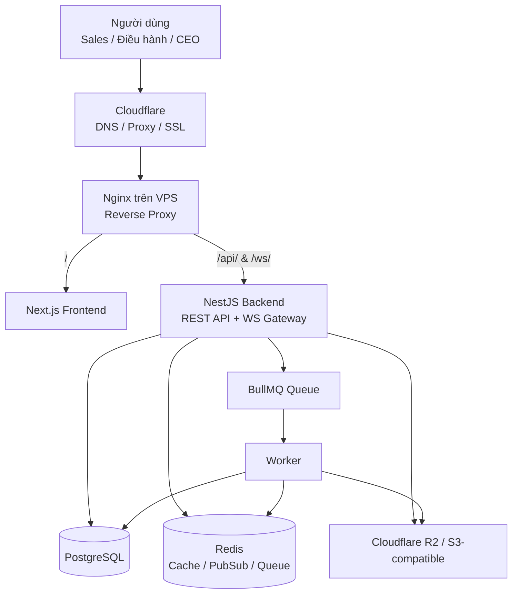
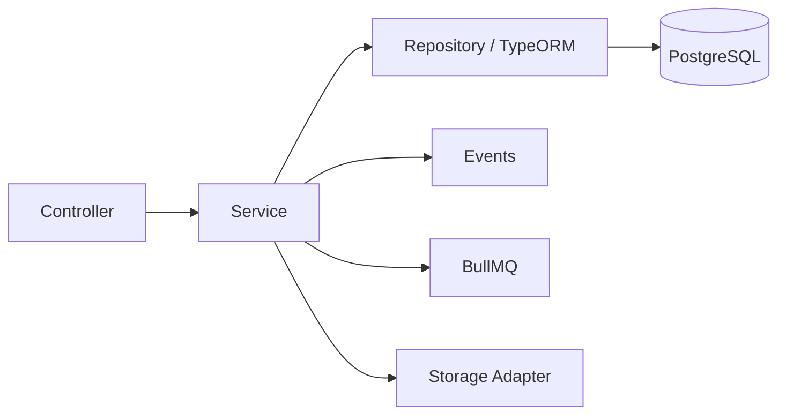
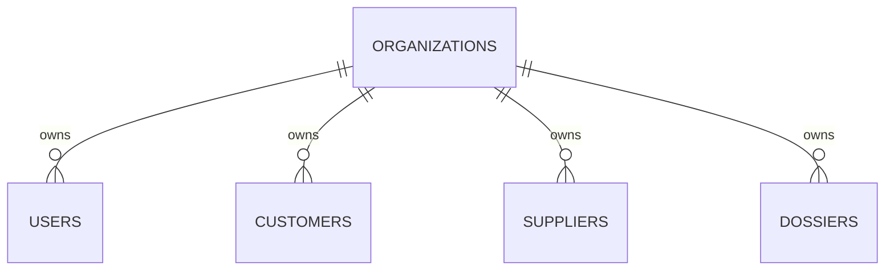

# SkyLux — Architecture

## 1. Mục đích

Tài liệu này mô tả kiến trúc kỹ thuật cho **SkyLux Phase 1–2**, dựa trên:

- tài liệu thiết kế cơ sở dữ liệu SkyLux;
- tài liệu Project Structure / Docker / Deployment / CI/CD;
- phạm vi chức năng Phase 1 và Phase 2;
- bộ màn hình tham chiếu của **Sales**, **Điều hành** và **CEO/Admin**.

Phạm vi hiện tại là hệ thống quản trị nội bộ doanh nghiệp du lịch. Kiến trúc được chuẩn bị để có thể mở rộng multi-tenant ở giai đoạn sau nhưng **không triển khai toàn bộ SaaS ngay trong Phase 1–2**.

> Ghi chú nguồn: tài liệu database cũ vẫn có một số chỗ ghi `Prisma`. Tài liệu cấu trúc triển khai mới hơn xác định Backend là **NestJS + TypeORM**. Phần kiến trúc triển khai trong bộ docs này sử dụng **TypeORM**, trong khi giữ nguyên mô hình dữ liệu PostgreSQL đã thiết kế.

---

## 2. Kiến trúc tổng thể



Luồng public:

```text
Internet
   ↓
app.skylux.vn
   ↓
Cloudflare
   ↓
VPS
   ↓
Nginx :443
   ├── /      → Next.js :3000
   ├── /api/  → NestJS REST :3001
   └── /ws/   → NestJS WebSocket Gateway :3001 (Socket.io)
```

PostgreSQL và Redis chỉ nằm trong private Docker network ở production, không expose trực tiếp ra Internet. Redis đóng vai trò làm Cache, BullMQ queue và Redis Pub/Sub Adapter cho WebSocket khi scale nhiều backend replica.

---

## 3. Kiến trúc repository

SkyLux sử dụng **một private GitHub repository** với bốn boundary rõ ràng:

```text
skylux/
├── frontend/
├── backend/
├── infra/
├── docs/
├── .github/
├── docker-compose.yml
├── docker-compose.prod.yml
├── .env.example
├── .gitignore
├── README.md
└── CHANGELOG.md
```

### 3.1. `frontend/`

Frontend là một project **Next.js** độc lập.

Trách nhiệm:

- App Router, layout và route;
- UI theo vai trò/quyền;
- Ant Design component;
- gọi REST API;
- query/cache;
- validation phía client;
- chart/dashboard;
- không truy cập PostgreSQL trực tiếp.

Boundary chính:

```text
frontend/src/
├── app/
├── components/
├── features/
├── services/
├── hooks/
├── lib/
├── types/
├── schemas/
└── constants/
```

### 3.2. `backend/`

Backend là một project **NestJS + TypeORM** độc lập.

Trách nhiệm:

- Authentication;
- tenant context;
- RBAC/permission;
- business logic;
- workflow hồ sơ;
- import Excel;
- transaction;
- PostgreSQL;
- Redis/BullMQ;
- object storage;
- audit log;
- report aggregation.

Boundary chính:

```text
backend/src/
├── config/
├── database/
├── common/
├── modules/
└── shared/
```

### 3.3. `infra/`

Không chứa business logic.

```text
infra/
├── nginx/
├── scripts/
└── monitoring/
```

Trách nhiệm:

- reverse proxy;
- deploy;
- backup/restore;
- monitoring;
- cấu hình vận hành.

### 3.4. `docs/`

```text
docs/
├── architecture/
├── database/
├── api/
├── business-flow/
└── deployment/
```

Mỗi folder chứa tài liệu được version cùng source code.

---

## 4. Backend architecture

SkyLux phù hợp với **Modular Monolith** trong Phase 1–2.



Các module chính:

```text
auth
organizations
users
departments
roles
permissions
customers
suppliers
master-data
dossiers
estimates
imports
approvals
documents
messaging
tasks
kpis
notifications
reports
audit-logs
settings
```

### Nguyên tắc module

- Controller chỉ xử lý HTTP boundary.
- Business logic nằm ở Service.
- Query DB qua TypeORM repository/query builder.
- Không để module gọi vòng tròn tùy tiện.
- Cross-cutting concern đặt trong `common/`.
- Provider bên ngoài đặt trong `shared/`.

---

## 5. Các pattern nên áp dụng

### 5.1. Layered / Service Layer

```text
Request
  ↓
Controller
  ↓
Service
  ↓
Repository
  ↓
PostgreSQL
```

Controller không chứa logic tài chính, workflow hoặc transaction.

### 5.2. State Machine cho hồ sơ/phê duyệt

Nguồn màn hình và tài liệu workflow thể hiện hồ sơ đi qua các mốc:

```text
DRAFT
  ↓
SUBMITTED
  ↓
IN_REVIEW
  ├── NEED_CHANGES
  │      ↓
  │  RESUBMITTED
  │      ↓
  └──── IN_REVIEW
         ↓
      APPROVED
         ↓
      COMPLETED
         ↓
       LOCKED
```

Không cho frontend update `status` tùy ý. Backend phải kiểm tra transition hợp lệ và permission.

### 5.3. Strategy / Adapter

Áp dụng cho provider có thể thay thế:

```text
StorageService
├── R2StorageAdapter
├── S3StorageAdapter
└── B2StorageAdapter
```

Business module chỉ phụ thuộc abstraction.

### 5.4. Pipeline cho Excel Import

```text
Upload
 ↓
File validation
 ↓
Parse
 ↓
Normalize
 ↓
Structure validation
 ↓
Business validation
 ↓
Duplicate validation
 ↓
Preview
 ↓
Confirm
 ↓
Transaction
```

Import không ghi trực tiếp vào bảng nghiệp vụ ngay khi upload.

### 5.5. Event / Observer

Phù hợp cho side effect:

```text
DossierApproved
├── Audit
├── Notification
└── Mail (nếu bật)
```

### 5.6. Producer–Consumer

BullMQ dùng cho tác vụ nền:

- parse Excel;
- notification;
- report/export lớn khi cần;
- file processing.

---

## 6. Multi-tenant boundary

Database được chuẩn bị từ Phase 1 bằng `organizations` và `organization_id`.



Quy tắc:

- không tin `organization_id` từ body/query của frontend;
- tenant lấy từ authenticated session/token context;
- mọi query nghiệp vụ phải scope theo organization;
- code nghiệp vụ không hard-code role;
- quyền dựa trên permission.

---

## 7. UI architecture theo role nhưng không tách source theo role

Bộ màn hình tham chiếu cho thấy ba trải nghiệm chính.

### Sales

- Bảng điều khiển;
- Hồ sơ của tôi;
- Import dự toán Excel;
- Khách hàng của tôi;
- Công việc của tôi;
- Tin nhắn;
- Hồ sơ cá nhân.

### Điều hành

- Bảng điều khiển;
- Hồ sơ chờ xử lý;
- Quản lý Sales;
- Doanh thu & thống kê;
- Công việc điều hành;
- Tin nhắn;
- Hồ sơ cá nhân.

### CEO/Admin

- Bảng điều khiển;
- Hồ sơ toàn hệ thống;
- Hồ sơ chờ duyệt;
- Doanh thu & thống kê;
- KPI Sales;
- Khách hàng & nhà cung cấp;
- Người dùng & phân quyền;
- Cấu hình hệ thống;
- Báo cáo;
- Tin nhắn;
- Hồ sơ cá nhân.

Frontend **không** nên tạo ba codebase hoặc ba bộ feature bị duplicate.

Nên dùng:

```text
route
  ↓
feature component
  ↓
permission check
  ↓
role-specific navigation / action visibility
```

Ví dụ:

```text
dossier.view.own
dossier.view.team
dossier.view.all
dossier.update
dossier.submit
dossier.approve
finance.view
report.export
user.manage
```

---

## 8. Dữ liệu và file

### PostgreSQL

Lưu:

- user/permission;
- customer/supplier;
- dossier;
- estimate version;
- revenue/cost line;
- workflow;
- task;
- KPI;
- audit;
- metadata tài liệu/import.

### Object storage

Lưu binary:

- Excel nguồn;
- hợp đồng;
- báo giá;
- hóa đơn;
- danh sách khách;
- file đính kèm;
- version tài liệu.

Database chỉ lưu:

```text
object_key
original_name
mime_type
file_size
checksum
```

---

## 9. Kiến trúc tài chính và reporting

Không tính dashboard chính thức bằng cách tải toàn bộ dữ liệu về browser.

Tổng hợp ở Backend/PostgreSQL:

```text
revenue_gross = SUM(revenue_lines.gross_amount)
revenue_net   = SUM(revenue_lines.net_amount)
cost_gross    = SUM(cost_lines.gross_amount)
cost_net      = SUM(cost_lines.net_amount)
profit        = revenue_net - cost_net
profit_margin = profit / revenue_net
```

Dashboard Phase 1–2 cần phục vụ:

- doanh thu theo tháng;
- doanh thu theo Sales;
- cơ cấu doanh thu theo mảng;
- doanh thu/lợi nhuận theo khách hàng;
- chi phí theo nhà cung cấp;
- KPI Sales;
- công nợ ở phạm vi Phase 2;
- trạng thái hồ sơ;
- workload/progress Phase 2.

---

## 10. Non-goals Phase 1–2

Theo tài liệu nguồn, chưa cần đưa vào core:

- Kubernetes;
- microservices;
- database riêng cho từng tenant;
- billing SaaS tự động;
- custom domain enterprise;
- AI/OCR;
- mobile application.

---

## 11. Tài liệu liên quan

- [Database](../database/README.md)
- [API](../api/README.md)
- [Business Flow](../business-flow/README.md)
- [Deployment](../deployment/README.md)
