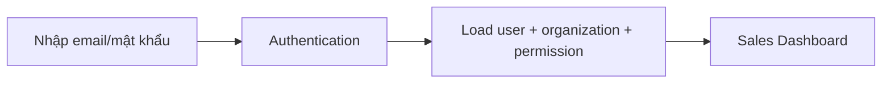
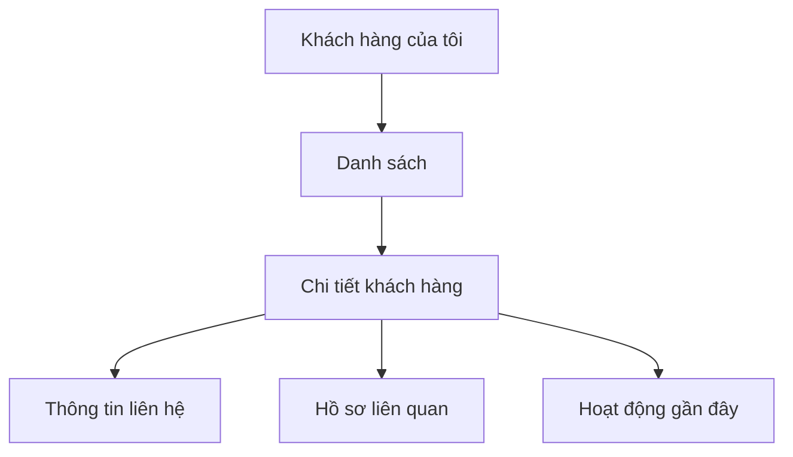
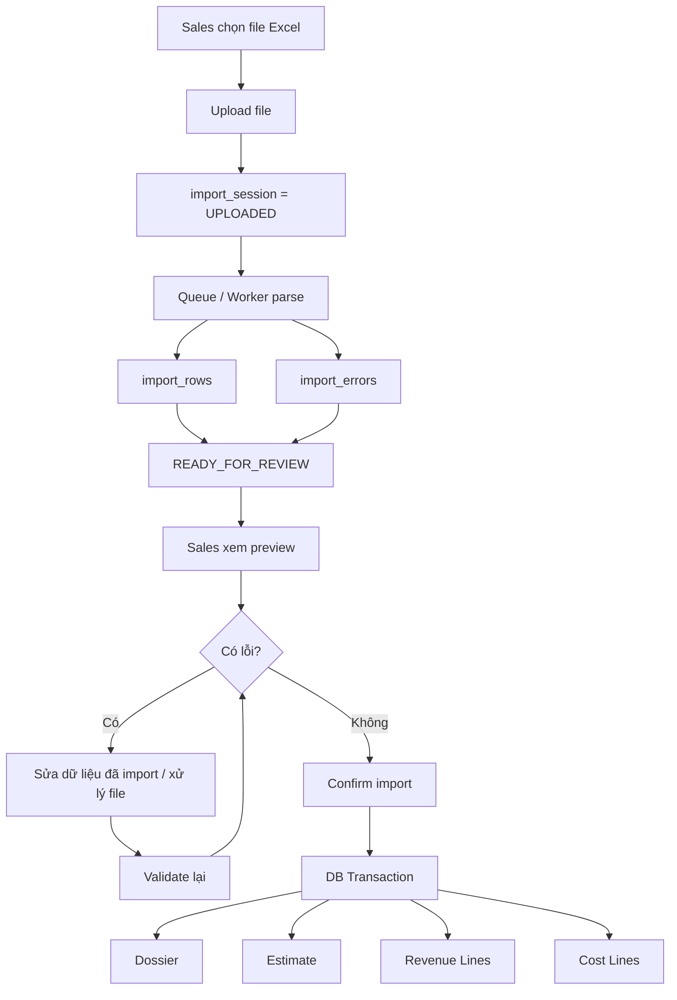
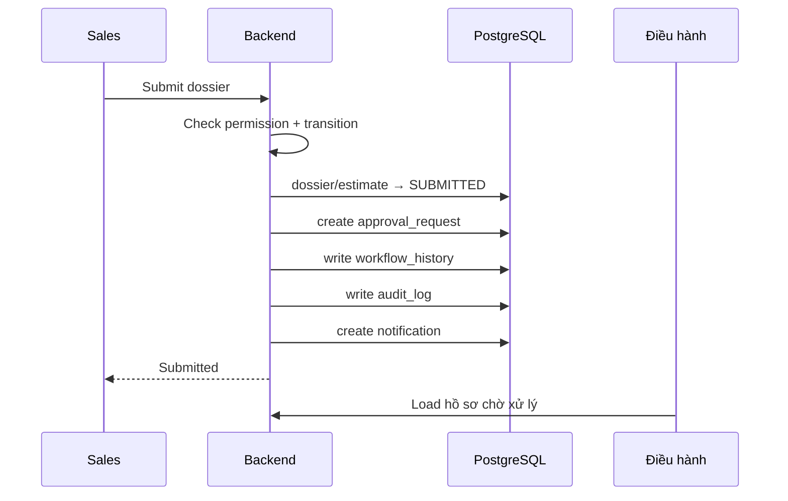
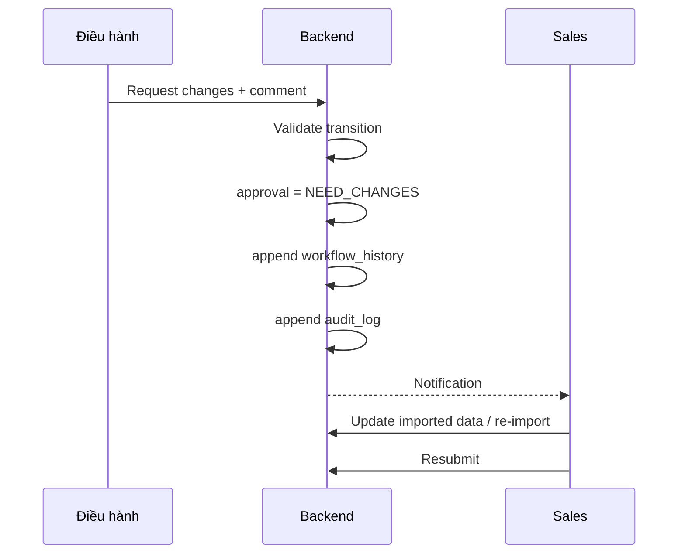
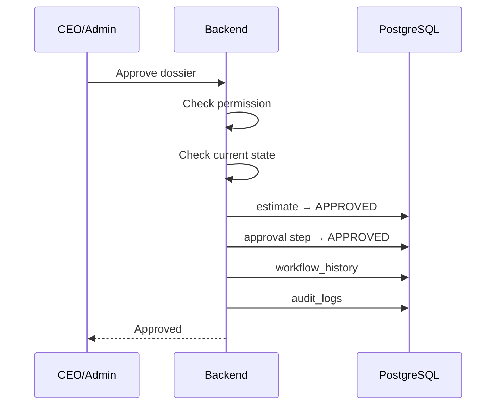
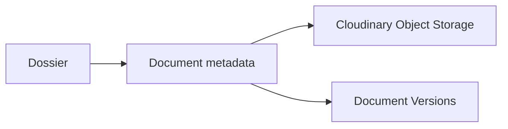
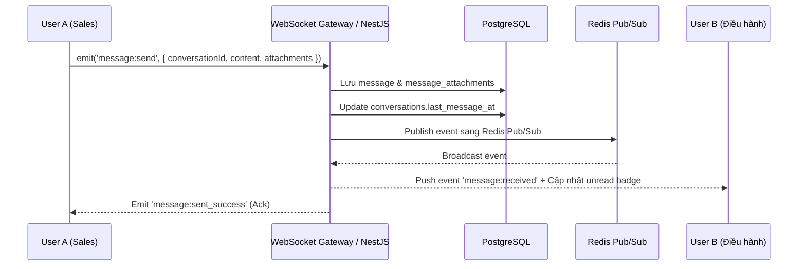

# SkyLux — Business Flow Phase 1–2

## 1. Phạm vi

Tài liệu này tổng hợp workflow từ:

- Phase 1 — Hệ thống quản lý nội bộ cốt lõi;
- Phase 2 — Quản lý quy trình và công việc;
- database workflow;
- màn hình tham chiếu Sales / Điều hành / CEO.

Ba actor cốt lõi:

```text
Sales
  ↓
Điều hành
  ↓
CEO/Admin
```

Phase 2 có thể mở rộng phê duyệt nhiều cấp nhưng rule chi tiết cần được khóa trước khi code.

---

# 2. Sales

Bộ màn hình tham chiếu Sales có:

```text
Bảng điều khiển
Hồ sơ của tôi
Import dự toán Excel
Khách hàng của tôi
Công việc của tôi
Tin nhắn
Hồ sơ cá nhân
```

## 2.1. Login



## 2.2. Dashboard Sales

Màn hình nguồn hiển thị:

- doanh thu tháng;
- hồ sơ đang xử lý;
- khách hàng đang chăm sóc;
- % KPI;
- biểu đồ doanh thu ngày;
- cơ cấu hồ sơ theo trạng thái;
- việc cần làm hôm nay;
- hồ sơ gần đây;
- nhắc nhở từ Điều hành.

Dashboard là summary, không phải nơi lưu số liệu riêng.

---

# 3. Customer flow

Phase 1 Sales quản lý khách hàng cá nhân/doanh nghiệp.



Customer doanh nghiệp có thể có nhiều contact.

---

# 4. Excel Import — luồng tạo dự toán chính

Nguồn database xác định import Excel là đường tạo dữ liệu dự toán chính.



### Quy tắc

- không ghi thẳng dữ liệu Excel vào core table trong HTTP upload;
- giữ file gốc;
- có staging;
- có preview;
- có error/warning;
- confirm mới tạo dữ liệu core;
- transaction phải rollback toàn bộ nếu một bước lỗi.

---

# 5. Hồ sơ sau import

Màn hình Sales chi tiết hồ sơ có:

- khách hàng;
- tuyến/chương trình;
- ngày đi;
- tổng thu;
- tổng chi;
- lợi nhuận;
- doanh thu theo khách/loại khách;
- chi phí dịch vụ;
- lịch sử xử lý;
- ghi chú Điều hành;
- action chỉnh dữ liệu nhập / tải file gốc / gửi Điều hành.

```text
Dossier
└── Current Estimate
    ├── Revenue Lines
    └── Cost Lines
```

---

# 6. Submit từ Sales sang Điều hành



---

# 7. Điều hành

Bộ màn hình tham chiếu Điều hành có:

```text
Bảng điều khiển
Hồ sơ chờ xử lý
Quản lý Sales
Doanh thu & thống kê
Công việc điều hành
Tin nhắn
Hồ sơ cá nhân
```

## 7.1. Hồ sơ chờ xử lý

Có filter:

- trạng thái;
- thời gian;
- Sales phụ trách;
- loại hình;
- khách hàng.

Summary:

```text
Tổng hồ sơ
Chờ xử lý
Cần bổ sung
Đã duyệt
```

## 7.2. Chi tiết hồ sơ

Màn hình có timeline:

```text
Draft
→ Đã gửi điều hành
→ Đang xem xét
→ Cần bổ sung
→ Đã duyệt
```

Điều hành xem:

- dossier metadata;
- doanh thu;
- chi phí;
- documents;
- nhận xét;
- lịch sử;
- Sales phụ trách.

## 7.3. Kiểm tra và chỉnh sửa dữ liệu nhập

Màn hình nguồn có bảng doanh thu/chi phí được parse từ Excel và cột validation.

Điều hành có thể:

- kiểm tra;
- chỉnh các field được phép;
- đọc warning/error;
- thêm ghi chú;
- yêu cầu bổ sung;
- duyệt dữ liệu khi đủ điều kiện.

Nếu thiếu hạng mục nguồn, workflow nguồn khuyến nghị trả lại Sales cập nhật file thay vì tự thêm dữ liệu không có nguồn.

---

# 8. Request Changes



Khi resubmit, estimate có thể tạo version mới theo rule versioning đã thống nhất.

---

# 9. Operator quản lý Sales

Phase 1 màn hình Quản lý Sales có:

- tổng Sales;
- số đạt KPI;
- số cần hỗ trợ;
- tổng hồ sơ;
- KPI theo Sales;
- doanh thu theo Sales;
- danh sách Sales;
- workload/status.

Điều hành không dùng dữ liệu ngoài organization.

---

# 10. CEO/Admin

Bộ màn hình tham chiếu CEO/Admin có:

```text
Bảng điều khiển
Hồ sơ toàn hệ thống
Hồ sơ chờ duyệt
Doanh thu & thống kê
KPI Sales
Khách hàng & nhà cung cấp
Người dùng & phân quyền
Cấu hình hệ thống
Báo cáo
Tin nhắn
Hồ sơ cá nhân
```

## 10.1. Dashboard CEO

Nguồn UI thể hiện:

- tổng doanh thu;
- lợi nhuận;
- hồ sơ đang xử lý;
- hồ sơ chờ duyệt;
- % KPI toàn bộ Sales;
- Sales hoạt động;
- doanh thu theo tháng;
- cơ cấu doanh thu theo mảng;
- trạng thái hồ sơ;
- top Sales.

## 10.2. Hồ sơ toàn hệ thống

CEO/Admin có filter toàn hệ thống theo:

- trạng thái;
- thời gian;
- mảng;
- Sales;
- Điều hành;
- khách hàng.

## 10.3. Hồ sơ chờ duyệt

Action nguồn:

```text
Xem hồ sơ
Duyệt hồ sơ
Yêu cầu bổ sung
```

---

# 11. CEO Approval



Approved estimate cần được bảo vệ khỏi chỉnh trực tiếp.

---

# 12. State machine đề xuất

Nguồn UI/database thể hiện các trạng thái tương đương sau:

```text
DRAFT
SUBMITTED
IN_REVIEW
NEED_CHANGES
RESUBMITTED
APPROVED
COMPLETED
LOCKED
CANCELLED
```

Transition:

```text
DRAFT
 └── SUBMITTED

SUBMITTED
 └── IN_REVIEW

IN_REVIEW
 ├── NEED_CHANGES
 └── APPROVED

NEED_CHANGES
 └── RESUBMITTED

RESUBMITTED
 └── IN_REVIEW

APPROVED
 └── COMPLETED

COMPLETED
 └── LOCKED
```

Tên enum cuối cùng cần FE/BE thống nhất để tránh UI dùng label khác backend.

---

# 13. Documents

Phase 1:

- upload;
- xem;
- download;
- phân loại;
- gắn với dossier/estimate.

Phase 2:

- version mới;
- xem version history.



File binary nằm ngoài PostgreSQL.

---

# 14. Task / Checklist — Phase 2

Sales:

- xem công việc;
- checklist;
- progress;
- deadline;
- phản hồi vướng mắc;
- đề nghị gia hạn;
- lịch/nhắc việc.

Điều hành:

- tạo/giao việc;
- priority;
- deadline;
- checklist;
- workload;
- overdue;
- báo cáo hoạt động.

Flow:

```text
TODO
 ↓
IN_PROGRESS
 ├── WAITING
 └── COMPLETED
```

---

# 15. Payments / Debt — Phase 2

Phase 2 nguồn yêu cầu:

Sales:

- ghi nhận lần thanh toán;
- upload chứng từ.

Điều hành:

- nhiều lần thanh toán;
- tuổi nợ;
- cảnh báo quá hạn;
- chứng từ.

CEO:

- dashboard công nợ;
- report quản trị.

Rule:

```text
remaining debt
= giá trị phải thu hợp lệ
- tổng payment hợp lệ
```

Không để user sửa trực tiếp một field công nợ tổng.

---

# 16. Accounting Period — Phase 2

CEO/Admin:

```text
Create period
  ↓
OPEN
  ↓
LOCK
```

Khi `LOCKED`:

- backend chặn thay đổi số liệu tài chính thuộc kỳ;
- unlock cần reason;
- unlock phải audit.

---

# 17. KPI

Phase 1:

- KPI cơ bản;
- revenue;
- dossier count;
- close rate nếu dữ liệu đủ.

Phase 2:

- dashboard quản trị sâu hơn;
- workload;
- hiệu suất bộ phận.

Nguồn database cho phép snapshot `kpi_results` khi cần khóa kỳ.

---

# 18. Reports

Phase 1:

- doanh thu;
- chi phí;
- lợi nhuận;
- công nợ cơ bản nếu scope áp dụng;
- KPI;
- trạng thái hồ sơ;
- export Excel/PDF.

Phase 2:

- công việc;
- progress;
- đối tác;
- debt detail;
- workflow;
- quản trị tổng hợp.

Dashboard chính thức phải lấy số aggregate từ backend/PostgreSQL.

---

# 19. Audit

Các action cần audit tối thiểu:

```text
LOGIN
CREATE/UPDATE CUSTOMER
IMPORT EXCEL
CONFIRM IMPORT
SUBMIT DOSSIER
UPDATE ESTIMATE LINE
REQUEST CHANGES
APPROVE
LOCK/UNLOCK PERIOD
USER/ROLE/PERMISSION CHANGE
DOCUMENT CHANGE
PAYMENT CHANGE
```

Audit lưu actor/action/entity/before/after/request_id.

---

# 20. Messaging & Chat Workflow

Hệ thống cung cấp tính năng nhắn tin & chat nội bộ realtime giữa các vai trò (Sales, Điều hành, CEO/Admin), hỗ trợ 3 quy trình trao đổi chính:

1. **Direct Chat (1:1)**: Trao đổi cá nhân giữa 2 người dùng (ví dụ: Sales hỏi nhanh thông tin từ Điều hành).
2. **Group Chat**: Tạo nhóm trao đổi công việc theo phòng ban hoặc dự án.
3. **Dossier Chat (Chat theo hồ sơ)**: Kênh nhắn tin được gắn trực tiếp với ngữ cảnh một hồ sơ (`dossier_id`). Khi hồ sơ được tạo hoặc chuyển cho Điều hành xử lý, kênh chat tự động hoặc chủ động gom Sales phụ trách và Điều hành xử lý vào chung một luồng trao đổi mà không bị lẫn với các hồ sơ khác.

### Luồng tin nhắn Realtime (Sequence Diagram)



### Quy tắc nghiệp vụ

- Khi nhắn tin đính kèm tệp, tệp được upload lên Object Storage qua API upload trước, sau đó `file_url` và metadata được lưu trong `message_attachments`.
- Người dùng khi mở khung chat sẽ tự động gửi `message:read` để cập nhật `last_read_message_id`, giảm số thông báo tin chưa đọc trên giao diện Header.

---

# 21. Các điểm chưa được nguồn khóa hoàn toàn

Các mục dưới đây cần business sign-off trước khi coi là requirement cuối:

1. `revenue_recognition_date` dùng ngày nào để tính báo cáo;
2. Điều hành và CEO duyệt tuần tự hay có case song song;
3. Rule tạo estimate version mới khi request changes;
4. Phase 2 phê duyệt nhiều cấp theo điều kiện cụ thể nào;
5. Công thức KPI cuối cùng;
6. Rule lock/unlock kỳ và quyền unlock.

*(Lưu ý: Tính năng Nhắn tin & Chat nội bộ đã được chốt và thống nhất thiết kế đầy đủ ở các tầng Database, API Contract, Architecture và Business Flow).*

---

# 22. Tài liệu liên quan

- [Architecture](../architecture/README.md)
- [Database](../database/README.md)
- [API](../api/README.md)
- [Deployment](../deployment/README.md)
