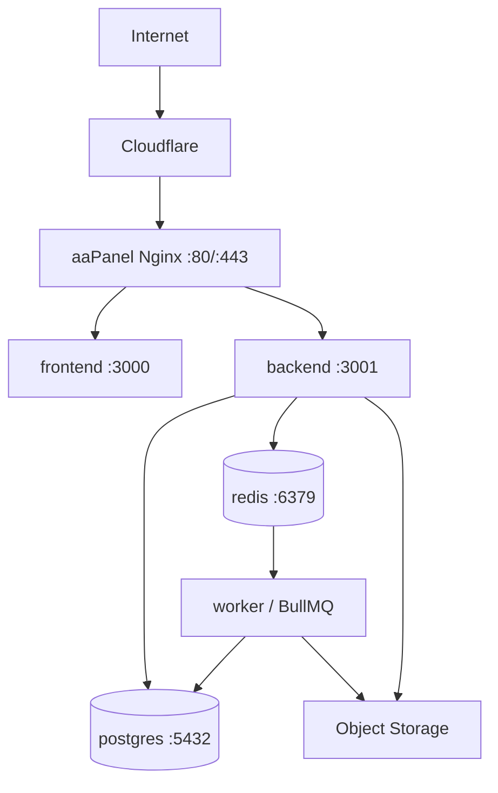

# SkyLux — Deployment, Docker & CI/CD

## 1. Mục tiêu

Phase 1–2 deploy theo kiến trúc đơn giản:

```text
Cloudflare
   ↓
1 VPS Ubuntu
   ↓
Docker Compose
```

Không cần Kubernetes hoặc microservices trong phạm vi hiện tại.

---

# 2. Runtime architecture



Production chỉ expose:

```text
22  SSH
80  HTTP
443 HTTPS
```

Không expose ra Internet:

```text
3000
3001
5432
6379
```

---

# 3. Repo dùng để deploy

```text
skylux/
├── frontend/
│   └── Dockerfile
├── backend/
│   └── Dockerfile
├── infra/
│   ├── nginx/
│   ├── scripts/
│   └── monitoring/
├── docs/
├── .github/workflows/
├── docker-compose.yml
└── docker-compose.prod.yml
```

---

# 4. Local development

Mục tiêu local theo tài liệu nguồn:

- Next.js chạy hot reload trên host;
- NestJS chạy hot reload trên host;
- PostgreSQL + Redis chạy Docker.

## `docker-compose.yml`

```yaml
services:
  postgres:
    image: postgres:17-alpine
    container_name: skylux-postgres
    restart: unless-stopped
    environment:
      POSTGRES_DB: skylux
      POSTGRES_USER: skylux
      POSTGRES_PASSWORD: skylux_local_password
    ports:
      - "5432:5432"
    volumes:
      - postgres_data:/var/lib/postgresql/data
    healthcheck:
      test: ["CMD-SHELL", "pg_isready -U skylux -d skylux"]
      interval: 10s
      timeout: 5s
      retries: 5

  redis:
    image: redis:7-alpine
    container_name: skylux-redis
    restart: unless-stopped
    ports:
      - "6379:6379"
    volumes:
      - redis_data:/data
    healthcheck:
      test: ["CMD", "redis-cli", "ping"]
      interval: 10s
      timeout: 5s
      retries: 5

volumes:
  postgres_data:
  redis_data:
```

Chạy:

```bash
docker compose up -d postgres redis
```

Backend:

```bash
cd backend
npm ci
npm run migration:run
npm run start:dev
```

Frontend:

```bash
cd frontend
npm ci
npm run dev
```

---

# 5. Frontend Dockerfile

Nguồn cấu trúc sử dụng multi-stage image và Next standalone output.

`frontend/next.config.ts`:

```ts
import type { NextConfig } from "next";

const nextConfig: NextConfig = {
  output: "standalone",
};

export default nextConfig;
```

`frontend/Dockerfile`:

```dockerfile
FROM node:22-alpine AS deps
WORKDIR /app
COPY package*.json ./
RUN npm ci

FROM node:22-alpine AS builder
WORKDIR /app
COPY --from=deps /app/node_modules ./node_modules
COPY . .
ENV NEXT_TELEMETRY_DISABLED=1
RUN npm run build

FROM node:22-alpine AS runner
WORKDIR /app
ENV NODE_ENV=production
ENV NEXT_TELEMETRY_DISABLED=1

RUN addgroup --system --gid 1001 nodejs \
 && adduser --system --uid 1001 nextjs

COPY --from=builder /app/public ./public
COPY --from=builder --chown=nextjs:nodejs /app/.next/standalone ./
COPY --from=builder --chown=nextjs:nodejs /app/.next/static ./.next/static

USER nextjs

EXPOSE 3000
ENV PORT=3000
ENV HOSTNAME="0.0.0.0"

CMD ["node", "server.js"]
```

`frontend/.dockerignore`:

```text
node_modules
.next
.git
.github
.env
.env.*
!.env.example
npm-debug.log*
README.md
```

---

# 6. Backend Dockerfile

`backend/Dockerfile`:

```dockerfile
FROM node:22-alpine AS deps
WORKDIR /app
COPY package*.json ./
RUN npm ci

FROM node:22-alpine AS builder
WORKDIR /app
COPY --from=deps /app/node_modules ./node_modules
COPY . .
RUN npm run build
RUN npm prune --omit=dev

FROM node:22-alpine AS runner
WORKDIR /app
ENV NODE_ENV=production

RUN addgroup --system --gid 1001 nestjs \
 && adduser --system --uid 1001 nestjs

COPY --from=builder --chown=nestjs:nestjs /app/node_modules ./node_modules
COPY --from=builder --chown=nestjs:nestjs /app/dist ./dist
COPY --from=builder --chown=nestjs:nestjs /app/package*.json ./

USER nestjs

EXPOSE 3001

CMD ["node", "dist/main.js"]
```

`backend/.dockerignore`:

```text
node_modules
dist
coverage
.git
.github
.env
.env.*
!.env.example
npm-debug.log*
README.md
```

---

# 7. Production Docker Compose (aaPanel Nginx)

Trên VPS đã chạy aaPanel, dùng Nginx của aaPanel làm reverse proxy. Compose chỉ mở frontend và backend trên loopback; không chạy thêm Nginx container và không chiếm cổng public 80/443. Cấu hình chuẩn nằm trong `docker-compose.prod.yml`.

```text
Internet → aaPanel Nginx :80/:443
  /api/* → 127.0.0.1:3001 → backend container :3001
  /*      → 127.0.0.1:3002 → frontend container :3000
```

PostgreSQL và Redis chỉ nằm trong Docker network, không publish port ra VPS. Frontend production được build với `NEXT_PUBLIC_API_URL=/api`, nên browser dùng cùng domain HTTPS và không cần URL/IP public riêng cho API.

---

# 8. Production environment

`.env` production tại `/opt/skylux/.env` không commit. Tạo giá trị bí mật riêng trên VPS; không dùng placeholder từ `.env.example`.

```env
NODE_ENV=production
APP_PORT=3001
APP_VERSION=<git-sha>
REGISTRY_OWNER=<github-owner-or-organization>

DB_HOST=postgres
DB_PORT=5432
DB_NAME=skylux
DB_USER=skylux
DB_PASSWORD=<long-random-secret>

REDIS_HOST=redis
REDIS_PORT=6379
JWT_SECRET=<long-random-secret>

R2_ENDPOINT=...
R2_ACCESS_KEY_ID=...
R2_SECRET_ACCESS_KEY=...
R2_BUCKET=skylux-files
```

Giới hạn quyền file: `chmod 600 /opt/skylux/.env`. Nếu thay owner GitHub, dùng đúng owner viết thường mà workflow dùng cho image GHCR.

---

# 9. aaPanel Nginx reverse proxy

Trong aaPanel chọn website/domain và thêm reverse proxy theo các route sau. Không thay chứng chỉ TLS trong aaPanel; panel tiếp tục xử lý HTTPS. Thay domain trong aaPanel bằng domain thực tế của website.

```nginx
# API và SSE; đặt các location SSE trước location /api/
location ~ ^/api/(notifications/stream|conversations/stream|chat/conversations/[^/]+/stream) {
    proxy_pass http://127.0.0.1:3001;
    proxy_http_version 1.1;
    proxy_set_header Connection '';
    proxy_buffering off;
    proxy_cache off;
    proxy_read_timeout 24h;
    proxy_send_timeout 24h;
    proxy_set_header Host $host;
    proxy_set_header X-Real-IP $remote_addr;
    proxy_set_header X-Forwarded-For $proxy_add_x_forwarded_for;
    proxy_set_header X-Forwarded-Proto $scheme;
}

location /api/ {
    proxy_pass http://127.0.0.1:3001;
    proxy_http_version 1.1;
    proxy_set_header Host $host;
    proxy_set_header X-Real-IP $remote_addr;
    proxy_set_header X-Forwarded-For $proxy_add_x_forwarded_for;
    proxy_set_header X-Forwarded-Proto $scheme;
}

location / {
    proxy_pass http://127.0.0.1:3002;
    proxy_http_version 1.1;
    proxy_set_header Host $host;
    proxy_set_header X-Real-IP $remote_addr;
    proxy_set_header X-Forwarded-For $proxy_add_x_forwarded_for;
    proxy_set_header X-Forwarded-Proto $scheme;
}
```

Trong aaPanel, bảo đảm `/api/` đi tới backend và `/` đi tới frontend; bật WebSocket/SSE support nếu panel có tùy chọn đó. Nếu aaPanel đã sinh `location /` mặc định, sửa location mặc định thành frontend thay vì tạo block trùng. Kiểm tra cấu hình Nginx trong panel trước khi reload.

Sau khi Compose chạy, xác nhận cổng chỉ lắng nghe trên loopback:

```bash
cd /opt/skylux
docker compose -f docker-compose.prod.yml ps
curl -I http://127.0.0.1:3002/
curl -i http://127.0.0.1:3001/api/health
```

Từ máy bên ngoài, truy cập domain HTTPS và thử dashboard/API. DNS A của domain phải trỏ tới IP VPS; địa chỉ `127.0.0.1` chỉ dùng giữa aaPanel và ứng dụng trên cùng VPS.

---

# 10. Cloudflare

DNS:

```text
A
app
→ 103.179.174.159
Proxy ON
```

SSL:

```text
Full (strict)
```

Origin certificate:

- Cloudflare Origin Certificate; hoặc
- Let's Encrypt.

Không cache tùy tiện private API response.

---

# 11. Setup VPS lần đầu

## Update

```bash
sudo apt update && sudo apt upgrade -y
sudo timedatectl set-timezone Asia/Ho_Chi_Minh
```

## Deploy user

```bash
sudo adduser deploy
sudo usermod -aG sudo deploy

sudo mkdir -p /home/deploy/.ssh
sudo chmod 700 /home/deploy/.ssh
```

Đưa public SSH key vào:

```text
/home/deploy/.ssh/authorized_keys
```

Sau đó:

```bash
sudo chmod 600 /home/deploy/.ssh/authorized_keys
sudo chown -R deploy:deploy /home/deploy/.ssh
```

## Firewall

```bash
sudo ufw default deny incoming
sudo ufw default allow outgoing

sudo ufw allow OpenSSH
sudo ufw allow 80/tcp
sudo ufw allow 443/tcp

sudo ufw enable
sudo ufw status
```

## Docker

Cài Docker Engine + Compose plugin, sau đó:

```bash
sudo usermod -aG docker deploy
```

Đăng nhập lại session.

Verify:

```bash
docker --version
docker compose version
```

## Deploy directory

```bash
sudo mkdir -p /opt/skylux
sudo chown -R deploy:deploy /opt/skylux
```

---

# 12. Deploy manual ban đầu

Khi pipeline chưa ổn định:

```bash
cd /opt
git clone git@github.com:YOUR_ORG/skylux.git
cd skylux

cp .env.example .env
# Điền secret

docker compose -f docker-compose.prod.yml build
docker compose -f docker-compose.prod.yml up -d
docker compose -f docker-compose.prod.yml ps
```

Cách này phù hợp staging ban đầu.

Production ổn định nên chuyển sang image registry.

---

# 13. CI

## Frontend CI

`.github/workflows/ci-frontend.yml`

```yaml
name: Frontend CI

on:
  pull_request:
    paths:
      - "frontend/**"
      - ".github/workflows/ci-frontend.yml"

  push:
    branches: [develop, main]
    paths:
      - "frontend/**"

jobs:
  frontend:
    runs-on: ubuntu-latest

    defaults:
      run:
        working-directory: frontend

    steps:
      - uses: actions/checkout@v4

      - uses: actions/setup-node@v4
        with:
          node-version: 22
          cache: npm
          cache-dependency-path: frontend/package-lock.json

      - run: npm ci
      - run: npm run lint
      - run: npm run build
```

## Backend CI

`.github/workflows/ci-backend.yml`

```yaml
name: Backend CI

on:
  pull_request:
    paths:
      - "backend/**"
      - ".github/workflows/ci-backend.yml"

  push:
    branches: [develop, main]
    paths:
      - "backend/**"

jobs:
  backend:
    runs-on: ubuntu-latest

    defaults:
      run:
        working-directory: backend

    steps:
      - uses: actions/checkout@v4

      - uses: actions/setup-node@v4
        with:
          node-version: 22
          cache: npm
          cache-dependency-path: backend/package-lock.json

      - run: npm ci
      - run: npm run lint
      - run: npm run test -- --runInBand
      - run: npm run build
```

---

# 14. Build Docker images

Một repo vẫn build hai image độc lập.

```text
frontend/
→ ghcr.io/ORG/skylux-frontend:<sha>

backend/
→ ghcr.io/ORG/skylux-backend:<sha>
```

Workflow:

```yaml
name: Build Images

on:
  push:
    branches: [main]

permissions:
  contents: read
  packages: write

jobs:
  build:
    runs-on: ubuntu-latest

    strategy:
      matrix:
        include:
          - service: frontend
            context: ./frontend
            image: skylux-frontend

          - service: backend
            context: ./backend
            image: skylux-backend

    steps:
      - uses: actions/checkout@v4

      - uses: docker/setup-buildx-action@v3

      - uses: docker/login-action@v3
        with:
          registry: ghcr.io
          username: ${{ github.actor }}
          password: ${{ secrets.GITHUB_TOKEN }}

      - uses: docker/build-push-action@v6
        with:
          context: ${{ matrix.context }}
          push: true
          tags: |
            ghcr.io/${{ github.repository_owner }}/${{ matrix.image }}:${{ github.sha }}
            ghcr.io/${{ github.repository_owner }}/${{ matrix.image }}:latest
```

Production rollback phải dùng immutable SHA tag, không chỉ dựa vào `latest`.

---

# 15. CD production

Nguồn deployment khuyến nghị production deploy thủ công qua GitHub Environment/approval.

```yaml
name: Deploy Production

on:
  workflow_dispatch:
    inputs:
      version:
        description: "Git SHA/image tag to deploy"
        required: true

jobs:
  deploy:
    environment: production
    runs-on: ubuntu-latest

    steps:
      - name: Deploy via SSH
        uses: appleboy/ssh-action@v1
        with:
          host: ${{ secrets.VPS_HOST }}
          username: ${{ secrets.VPS_USER }}
          key: ${{ secrets.VPS_SSH_KEY }}
          script: |
            cd /opt/skylux
            export APP_VERSION=${{ inputs.version }}

            docker compose -f docker-compose.prod.yml pull
            docker compose -f docker-compose.prod.yml run --rm backend npm run migration:run
            docker compose -f docker-compose.prod.yml up -d --remove-orphans

            docker image prune -f
```

---

# 16. Pipeline đề xuất

```text
FEATURE
────────
Developer
 ↓
feature branch
 ↓
Pull Request
 ↓
CI frontend/backend
 ↓
Merge develop
 ↓
Deploy staging
 ↓
UAT

PRODUCTION
──────────
Merge main / release
 ↓
CI pass
 ↓
Build frontend/backend image
 ↓
Push GHCR bằng Git SHA
 ↓
Manual production approval
 ↓
VPS pull image
 ↓
Backup DB
 ↓
Run migration
 ↓
docker compose up -d
 ↓
Healthcheck
```

---

# 17. TypeORM migration

Production:

```text
synchronize = false
```

Schema thay đổi qua migration đã review.

Ví dụ scripts:

```json
{
  "scripts": {
    "typeorm": "typeorm-ts-node-commonjs -d src/database/data-source.ts",
    "migration:generate": "npm run typeorm -- migration:generate",
    "migration:run": "npm run typeorm -- migration:run",
    "migration:revert": "npm run typeorm -- migration:revert"
  }
}
```

Deploy sequence an toàn:

```text
Backup DB
 ↓
Pull image
 ↓
Run migration
 ↓
Start/recreate app containers
 ↓
Healthcheck
```

Migration destructive phải test staging trước.

---

# 18. Backup PostgreSQL

`infra/scripts/backup-db.sh`:

```bash
#!/usr/bin/env bash
set -euo pipefail

DATE=$(date +%Y-%m-%d_%H-%M-%S)
BACKUP_DIR=/opt/skylux/backups

mkdir -p "$BACKUP_DIR"

cd /opt/skylux

docker compose -f docker-compose.prod.yml exec -T postgres \
  pg_dump -U "$DB_USER" -d "$DB_NAME" -Fc \
  > "$BACKUP_DIR/skylux-$DATE.dump"

gzip "$BACKUP_DIR/skylux-$DATE.dump"

# Upload .gz sang R2/B2/S3 off-VPS.
```

Không chỉ giữ backup trên cùng VPS.

---

# 19. Restore

`infra/scripts/restore-db.sh`:

```bash
#!/usr/bin/env bash
set -euo pipefail

BACKUP_FILE="$1"

gunzip -c "$BACKUP_FILE" | \
docker compose -f docker-compose.prod.yml exec -T postgres \
  pg_restore -U "$DB_USER" -d "$DB_NAME" --clean --if-exists
```

Backup chỉ được coi là an toàn khi đã test restore.

---

# 20. Monitoring

Health:

```http
GET /api/health
```

Expected:

```json
{
  "status": "ok",
  "database": "ok",
  "redis": "ok"
}
```

Logging:

```text
NestJS technical log → stdout/stderr
aaPanel Nginx access/error → aaPanel website logs
Business audit        → PostgreSQL audit_logs
Error tracking        → Sentry hoặc tương đương
```

---

# 21. Security checklist

- không commit `.env`;
- không commit R2 keys;
- không commit JWT secret;
- không expose PostgreSQL/Redis;
- Cloudflare SSL Full (strict);
- SSH bằng key;
- giới hạn SSH IP nếu khả thi;
- container non-root khi có thể;
- patch Ubuntu/Docker định kỳ;
- enforce RBAC/tenant ở backend;
- backup off-VPS.

---

# 22. Rollback

Application:

```bash
cd /opt/skylux

export APP_VERSION=<previous-good-sha>

docker compose -f docker-compose.prod.yml pull
docker compose -f docker-compose.prod.yml up -d
```

Database rollback **không đồng nghĩa** app rollback.

Không tự động `migration:revert` cho mọi lỗi. Với migration destructive, có thể cần:

- restore backup; hoặc
- forward-fix migration.

---

# 23. Lệnh chẩn đoán

```bash
docker compose -f docker-compose.prod.yml ps

docker compose -f docker-compose.prod.yml logs --tail=200 backend
docker compose -f docker-compose.prod.yml logs --tail=200 frontend

docker stats
df -h
free -h
```

---

# 24. Checklist trước go-live

```text
[ ] frontend build production OK
[ ] backend build/test OK
[ ] TypeORM synchronize=false
[ ] migration chạy staging OK
[ ] PostgreSQL không public
[ ] Redis không public
[ ] aaPanel proxy / và /api đúng tới loopback ports
[ ] Cloudflare Full (strict)
[ ] VPS firewall đúng
[ ] .env production không nằm trong Git
[ ] daily DB backup off-VPS
[ ] restore đã test
[ ] /api/health OK
[ ] CI PR hoạt động
[ ] Docker image có SHA tag
[ ] có previous-good-sha để rollback
```

---

# 25. Tài liệu liên quan

- [Architecture](../architecture/README.md)
- [Database](../database/README.md)
- [API](../api/README.md)
- [Business Flow](../business-flow/README.md)
