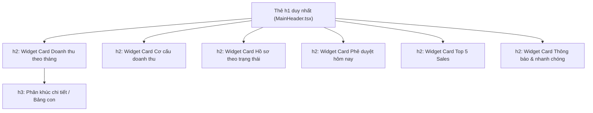

# Tài Liệu Chuẩn Hóa SEO, Semantic HTML & Page Metadata
## (Shipping Artifact: /shipping-artifacts • /redesign-existing-projects)

> **Phạm vi áp dụng:** Toàn bộ phân hệ Frontend (`frontend/app/` và `frontend/components/`).  
> **Mục tiêu:** Bảo vệ tính toàn vẹn ngữ nghĩa HTML5, tối ưu khả năng điều hướng đa tab của người dùng điều hành, và thiết lập hàng rào bảo mật dữ liệu tài chính trước các công cụ tìm kiếm bên ngoài.

---

## 1. HÀNG RÀO BẢO MẬT CHỈ SỐ TÀI CHÍNH (ROBOTS & CRAWLER BOUNDARY)

Hệ thống SkyLux là nền tảng quản trị nội bộ ERP/CRM xử lý các số liệu hợp đồng, doanh thu, lợi nhuận và thông tin cá nhân khách hàng. Mọi trang thuộc khu vực quản trị phải được bảo vệ tuyệt đối trước việc thu thập dữ liệu tự động của các bot tìm kiếm (Google, Bing, Baidu,...).

### Cấu hình chỉ thị Robots
Được khai báo tập trung tại [frontend/app/layout.tsx](file:///d:/Sky-Lux-Business/frontend/app/layout.tsx):

```typescript
export const metadata: Metadata = {
  title: 'Sky-Lux CRM - Hệ Thống Quản Lý Tour & Dự Toán Báo Giá',
  description: 'Nền tảng quản lý điều hành tour, dự toán chiết tính và CRM chuyên biệt cho Sky-Lux Travel Corporation',
  robots: {
    index: false,
    follow: false,
    noarchive: true,
    nosnippet: true,
  },
};
```

* **`index: false`**: Ngăn chặn bot lập chỉ mục các trang nội bộ.
* **`follow: false`**: Ngăn chặn bot theo dõi các liên kết nội bộ trong ứng dụng.
* **`noarchive: true`**: Ngăn lưu cache trang web trên máy chủ công cộng của công cụ tìm kiếm.
* **`nosnippet: true`**: Không trích xuất nội dung hiển thị trong bất kỳ kết quả tìm kiếm nào.

---

## 2. QUY CHUẨN CÂY NGỮ NGHĨA HTML (HEADING HIERARCHY CONTRACT)

Theo tiêu chuẩn HTML5 và Accessibility (WCAG 2.1), một trang web hợp lệ chỉ được phép tồn tại **duy nhất 1 thẻ `<h1>`** đóng vai trò tiêu đề ngữ cảnh chính của trang.



### Phân bổ tầng thẻ:
1. **Thẻ `<h1>` (Root Landmark):**
   * Đặt tại [frontend/components/layout/MainHeader.tsx](file:///d:/Sky-Lux-Business/frontend/components/layout/MainHeader.tsx#L154).
   * Giá trị lấy động từ `routeMeta.title` (Ví dụ: *"Bảng điều khiển"*, *"Hồ sơ chờ duyệt"*, *"Lịch trình điều hành"*).
   * Tuyệt đối không khai báo thêm thẻ `<h1>` trong các trang con (`app/main/*/page.tsx`).
2. **Thẻ `<h2>` (Section Landmarks):**
   * Sử dụng cho tiêu đề các khối Widget Card lớn trên Dashboard của CEO ([CeoDashboard.tsx](file:///d:/Sky-Lux-Business/frontend/components/ceo/CeoDashboard.tsx)):
     * *Doanh thu theo tháng*
     * *Cơ cấu doanh thu theo loại hình / mảng*
     * *Hồ sơ theo trạng thái*
     * *Phê duyệt cần xử lý hôm nay*
     * *Top 5 Sales theo doanh thu*
     * *Thông báo & nhanh chóng*
   * Sử dụng cho 6 khối Widget Card trên Dashboard của Điều Hành ([OperatorDashboard.tsx](file:///d:/Sky-Lux-Business/frontend/components/operator/OperatorDashboard.tsx)):
     * *Top Sales theo Hiệu suất*
     * *Cơ cấu doanh thu theo loại hình / mảng*
     * *Việc cần xử lý hôm nay*
     * *Nhắc nhở vận hành*
     * *Hồ sơ gần đây*
     * *Doanh thu Nhà cung cấp*
   * Sử dụng lớp CSS `text-[15px] font-bold text-slate-900 m-0` đảm bảo visual pixel-perfect đồng nhất với thiết kế ban đầu.
3. **Thẻ `<h3>` (Subsection Landmarks):**
   * Sử dụng cho các phân nhóm bảng dữ liệu chi tiết, ví dụ bảng Excel dự toán ([EstimateExcelTables.tsx](file:///d:/Sky-Lux-Business/frontend/components/ceo/EstimateExcelTables.tsx)).

---

## 3. ĐỒNG BỘ TIÊU ĐỀ TRÌNH DUYỆT ĐỘNG (DYNAMIC TAB METADATA)

Trong nghiệp vụ thực tế, CEO thường mở song song nhiều tab trình duyệt (Tab 1: Bảng điều khiển, Tab 2: Hồ sơ chờ duyệt, Tab 3: Lịch trình điều hành tour). Việc tab trình duyệt chỉ hiển thị một tiêu đề tĩnh sẽ gây nhầm lẫn và giảm tốc độ xử lý.

### Cơ chế đồng bộ:
Được quản lý tự động tại [frontend/app/main/layout.tsx](file:///d:/Sky-Lux-Business/frontend/app/main/layout.tsx):

```typescript
useEffect(() => {
  if (typeof document !== 'undefined') {
    const pageTitle = routeMeta.title || 'Bảng điều khiển';
    const roleSuffix = isCeoAdmin
      ? 'SkyLux CEO'
      : isOperator
      ? 'SkyLux Điều Hành'
      : isSales
      ? 'SkyLux Sales'
      : 'SkyLux Travel';
    document.title = `${pageTitle} | ${roleSuffix}`;
  }
}, [routeMeta.title, isCeoAdmin, isOperator, isSales]);
```

### Bảng định danh tab của CEO:
* Đường dẫn `/main/dashboard` $\rightarrow$ `Bảng Điều Khiển | SkyLux CEO`
* Đường dẫn `/main/approvals` $\rightarrow$ `Hồ Sơ Chờ Duyệt | SkyLux CEO`
* Đường dẫn `/main/tasks` $\rightarrow$ `Lịch Trình Điều Hành | SkyLux CEO`
* Đường dẫn `/main/dossiers` $\rightarrow$ `Hồ Sơ Toàn Hệ Thống | SkyLux CEO`
* Đường dẫn `/main/revenue` $\rightarrow$ `Doanh Thu & Thống Kê | SkyLux CEO`
* Đường dẫn `/main/reports` $\rightarrow$ `Báo Cáo | SkyLux CEO`

---

## 4. MA TRẬN KIỂM SOÁT LỖI HỒI QUY (REGRESSION GUARDRAILS)

| Quy tắc | Cách kiểm tra | Kết quả mong đợi |
| :--- | :--- | :--- |
| **Duy nhất 1 thẻ `<h1>`** | `grep -rn "<h1" frontend/app/main/` | Chỉ xuất hiện tại `MainHeader.tsx` |
| **Không dùng từ "từ API"** | `grep -i "từ API" frontend/components/` | 0 kết quả trong UI người dùng |
| **Tab Title động** | Mở tab trình duyệt, chuyển trang | Đổi tên tab tức thì theo tiêu đề route Meta |
| **Bảo mật bot index** | Kiểm tra thẻ `<meta name="robots">` | Chứa `noindex, nofollow, noarchive` |
